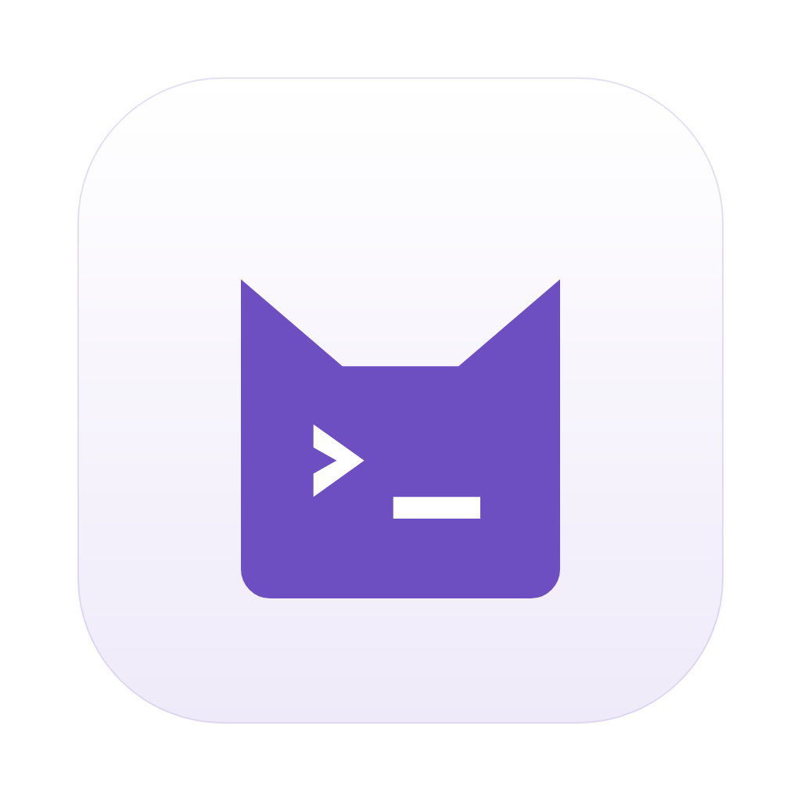

# nekcode

<div align="center">
  
</div>

nekcode 是终端编程助手 **nek** 的桌面图形界面，支持 Windows / macOS / Linux。

nekcode is the desktop GUI for the terminal coding agent `nek` on Windows, macOS and Linux. The Electron main
process drives `nek --mode rpc`; the renderer is React + Vite. It is a modified fork of
[ZCodium](https://github.com/axiom-desu/ZCodium) (Apache-2.0) — see [NOTICE.md](NOTICE.md) and
[THIRD-PARTY-NOTICES.md](THIRD-PARTY-NOTICES.md).

## 安装与启动（Windows）

1. 从 [GitHub Releases](https://github.com/deepdarkpaw/nekcode-gui/releases) 下载
   `nekcode-<版本>-win-x64.exe`（NSIS 安装包）并运行。安装向导可以选择安装目录，默认按当前用户安装到
   `%LOCALAPPDATA%\Programs
ekcode`，并创建开始菜单与桌面快捷方式「nekcode」。
2. 之后从开始菜单或桌面快捷方式启动；程序本体是安装目录下的 `nekcode.exe`。卸载在「设置 → 应用」里进行。
3. 首次启动的引导会检测本机的 nek；没有安装时可以在引导里一键安装（stable 渠道，即最新的 `nek-v*` 发布版）。

nekcode 需要 **nek 0.4.0 或更高版本**（GUI 协议版本 1，见
[nek v0.4.0](https://github.com/deepdarkpaw/nekcode/releases/tag/nek-v0.4.0)）；更旧的 nek 没有
`nek gui-info`，引导页会提示 nek 版本过旧。已安装的 nek 用 `nek update --channel stable` 升级。

安装包目前没有代码签名，Windows SmartScreen 可能提示「已保护你的电脑」，点「更多信息 → 仍要运行」即可。

## 它是什么

- **桌面壳**：窗口、菜单、快捷键、托盘图标、自动更新、本地 IPC 与远端会话都在本仓库的 Electron 进程里实现。
- **agent 不随包分发**：对话、工具执行与文件改动由本机的 nek CLI（[deepdarkpaw/nekcode](https://github.com/deepdarkpaw/nekcode)）完成（`nek --mode rpc`）。GUI 通过
  `nek gui-info --json` 校验协议版本；启动器查找顺序是「设置里配置的路径 → `PATH` 里的 `nek` →
  Windows 的 `%LOCALAPPDATA%\nekcode\bin\nek.cmd`、其他平台的 `~/.local/bin/nek`」。
- **配置同源**：设置中心直接读写 nek 的配置（`~/.nek/agent`），不在 GUI 侧另存一份模型与工具配置。
- **无遥测**：不含上报链路，诊断日志只落在本机（`scripts/ci/no-telemetry.test.mjs` 守卫）。

## 功能概览

| 能力         | 说明                                                                                            |
| ------------ | ----------------------------------------------------------------------------------------------- |
| 对话         | 流式会话、轮次跳转、会话内搜索、导出与导入、输入历史与草稿、大段粘贴折叠                        |
| nek 交互卡片 | `ask_question`、方案评审、模式切换、扩展对话框等需要用户决策的交互以卡片呈现并回传结果          |
| 状态面板     | 子代理卡片与记录、todo 面板、队列条、重试与压缩横幅、用量指示器                                 |
| 设置中心     | 13 页：账号、服务商、默认模型、压缩、工具、MCP、Agent、项目、外观、快捷键、高级、关于、远程主机 |
| 首次引导     | 首次启动时引导配置 nek 启动器、工作区与模型                                                     |
| 远程 SSH     | 远程主机页配置 SSH 目标，桌面端把 `gui-server` 部署到远端并在那里运行 nek                       |
| 快捷键       | 按 nek 动作 id 绑定与派发，可在设置中心查看和覆盖                                               |
| 自动更新     | electron-updater + GitHub Releases 通道（见下文「发布与自动更新」）                             |

nek 侧能力的对账状态见 [PARITY.md](PARITY.md)。

## 开发

### 环境

- Node `24.14.0`、pnpm `10.33.2`：版本由根 `package.json` 的 `packageManager` 与 `mise.toml` 固定，
  `scripts/ci/toolchain.mjs` 会在安装前校验两者一致。
- 安装依赖：

  ```bash
  HUSKY=0 pnpm install
  ```

  Electron 下载慢时设置 `ELECTRON_MIRROR=https://npmmirror.com/mirrors/electron/`；electron-builder 依赖下载慢时
  设置 `ELECTRON_BUILDER_BINARIES_MIRROR=https://npmmirror.com/mirrors/electron-builder-binaries/`。

### 构建

```bash
# 首次构建或远端运行时资源有变更时：生成 bundled-remote-assets 与当前平台的 bundled-tools
pnpm prepare:desktop-runtime

# 生产构建（workspace 各包 + 桌面端 out/）
ZCODE_ENV=production ZCODE_SKIP_REMOTE_ASSETS=1 pnpm build:bootstrap
```

`ZCODE_SKIP_REMOTE_ASSETS=1` 表示「远端运行时资产已就绪，不要重建」。它只跳过生成，不跳过校验：
`beforePack` / `afterPack` 仍会用随包 manifest 校验 `packages/desktop/bundled-remote-assets`，缺失时打包直接失败，
所以本地首次构建必须先执行 `pnpm prepare:desktop-runtime`。

### 运行

```bash
pnpm dev:desktop        # 开发态启动桌面端（独立的 dev 应用身份，不影响已安装的正式版）
```

开发态默认读写真实的 `~/.nek/gui`。需要完全隔离时设置 `ZCODE_DATA_BASE_DIR=<临时目录>`。

### 测试与门禁

```bash
pnpm typecheck                                               # tsc 项目引用全量检查
pnpm lint                                                    # oxlint
cd packages/ui && npx vitest run src                         # UI 套件
node --import tsx --test packages/services/test/*.test.ts    # services 套件
node --test --test-isolation=none scripts/ci/*.test.mjs      # CI 脚本与工作流测试
```

门禁是「棘轮」：存量债务收在 `.gate-baseline/` 里，只拦截新增违规。

```bash
pnpm gate:knip          # 未使用的导出、文件与依赖
pnpm gate:lint          # lint
pnpm gate:format        # 格式
pnpm architecture:check # 模块与分层边界
```

单个文件的格式化与检查：`npx oxfmt <files>`、`npx oxlint <files>`。

### 打包

本地生成 Windows 安装包只需要一条命令（正式身份 `nekcode`，构建 → 打包 → 运行时依赖校验 → 体积审计）：

```bash
pnpm dist:win
```

产物：

- `packages/desktop/dist/nekcode-<版本>-win-x64.exe`：安装包（setup），发给用户的就是它；
- `packages/desktop/dist/win-unpacked/nekcode.exe`：免安装目录，可直接运行，用于本地冒烟。

版本号是滚动版本 `<根 package.json 的 version>-<构建日期>.<提交数>`，例如 `0.1.0-20261102.400`。
没有设置 `ZCODE_ENV=production` 的构建是 Preview 身份（`nekcode-preview`，文件名带 `_TEST`），只用于测试，
可以与正式版并排安装。

其他平台与分步命令：

```bash
# 仓库标准入口：构建 → electron-builder → 运行时依赖校验 → 体积审计
pnpm bundle:desktop -- --os win --arch x64
pnpm bundle:desktop -- --os mac --arch arm64
pnpm bundle:desktop -- linux arm64

# 已有 out/ 时跳过重复构建
pnpm bundle:desktop -- --os win --arch x64 --skip-prepare --skip-build
```

产物写在 `packages/desktop/dist/`：Windows 是 NSIS 安装包 `nekcode-<version>-win-<arch>.exe`，macOS 是 `dmg` +
`zip`，Linux 是 `AppImage` / `deb` / `rpm` / `pkg.tar.zst`，同时生成 electron-updater 需要的 `latest*.yml`。

只生成未打包目录（本地冒烟，不签名、不发布）：

```bash
cd packages/desktop
pnpm exec electron-builder --config electron-builder.config.js --publish never --win --x64 --dir
```

Windows 本地打包提示：electron-builder 解压 `winCodeSign`（内含 `rcedit`）时会创建符号链接，非管理员且未开启
「开发者模式」的 Windows 会以 `Cannot create symbolic link` 失败；开启开发者模式或改用管理员终端执行即可。

## 数据与目录

| 路径                                | 内容                                                         |
| ----------------------------------- | ------------------------------------------------------------ |
| `~/.nek/gui`                        | 本机 GUI 数据根（`ZCODE_DATA_BASE_DIR` 可改写基路径）        |
| `~/.nek/gui/v2`                     | 会话与会话绑定、提供商与 agent 配置、证书、迁移备份          |
| `~/.nek/gui/v2/logs/diagnostics-v1` | 结构化诊断日志（界面上的「导出日志」读取这里）               |
| `~/.nek/agent`                      | nek 自己的配置，由 GUI 通过 nek 配置服务读写                 |
| `~/.nek/gui-server`                 | 远端主机安装根：`gui-server`、随包 node 运行时与 native 资源 |

## 发布与自动更新

- 推送 `v*` 标签触发 `.github/workflows/desktop.yml`：先跑检查，再打包三平台（Windows NSIS、macOS dmg/zip、
  Linux AppImage/deb/rpm/pacman，各含 x64 与 arm64），最后创建一个**草稿** Release，由维护者审核后手动发布。
- Release 资产包含安装包、`SHA256SUMS` 与 electron-updater 元数据 `latest.yml` / `latest-linux.yml` /
  `latest-linux-arm64.yml` / `latest-mac.yml`。同一平台的 x64 与 arm64 安装包会被合并进同一份元数据，Preview 身份
  另有 `latest-preview*.yml`，两个身份不会互相覆盖。
- 客户端实际请求的通道名由 electron-updater 按当前版本与 Release tag 的 prerelease 段推导，取不到时回退到
  `latest*.yml`；因此 Preview 版目前也通过 `latest*.yml` 更新，`latest-preview*.yml` 是为独立通道预留的产物。
- 安装包内的 `app-update.yml` 由 electron-builder 按 `publish: { provider: "github", owner, repo }` 生成，默认指向
  [`deepdarkpaw/nekcode-gui`](https://github.com/deepdarkpaw/nekcode-gui)，可用 `NEKCODE_UPDATE_OWNER` /
  `NEKCODE_UPDATE_REPO` 覆盖（fork 发版用）。
- 签名：只有配置了证书 secret（Windows `WINDOWS_CSC_LINK` + `WINDOWS_CSC_KEY_PASSWORD`；macOS `MACOS_CSC_LINK`
  - `MACOS_CSC_KEY_PASSWORD` + `MACOS_SIGNING_IDENTITY`）时才会签名。缺 secret 时产物保持未签名，并在工作流日志里
    给出明确提示。macOS 公证（notarize）尚未接入。

## 许可证

本项目以 Apache License 2.0 发布（[LICENSE](LICENSE)）。它基于 ZCodium（<https://github.com/axiom-desu/ZCodium>，
导入提交 `406fc34f`，2026-10-24）修改而来；ZCodium 及其上游 ZCode 同样以 Apache-2.0 发布，原有版权与许可声明完整
保留。修改说明、安全边界与第三方组件声明见 [NOTICE.md](NOTICE.md)，第三方许可证全文见
[THIRD-PARTY-NOTICES.md](THIRD-PARTY-NOTICES.md)（由 `node scripts/licenses.mjs notices` 生成）。
